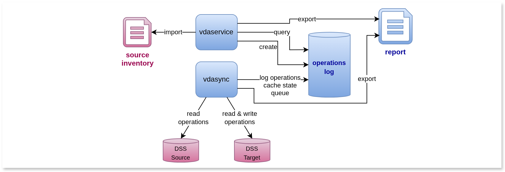

# Vdasync operations log

Operations log record events on source and target files
during their processing for synchronization

- to enable efficient operations at scale
- to provide reports for traceability

The `vdasync` CLI leverages operations log on option to enable those features.
This page provides information specific to this mode of operation.

## General operation

Using operations log to support a synchronization run is an option
of the `vdasync` command activated by the use of the `-oplcmd` flag.
When operations log is in use, each I/O operation on a source or target DSS is tracked in the log,
where they are cached and may avoid repeating the same when the synchronization is applied several times.

Status and events from the operations log can be exported in CSV format
and can thus support various traceability requirements.

The tool's behaviour may appear counterintuitive for the two following topics:

### Operations log and dryrun

The dryrun mode when activated with the related flag has the effect of avoiding any modification
to the target data storage.

The operations log on the other hand has to be updated to cache and track related read operations
on both the source and the target data storage.

### Operations log and log files

The standard log files, as configured with the flags

    -level string
        log level, defaults to INFO
    -log string
        log file, defaults to vdasync-<pid>.log in temp dir, "std[out|err]" are known keywords

are not to be confused with operations log.
Operations log are stored in files as well but are specific to long running operation and related traceability.
The operations log files are configured with the flags

    -oplpath string
            operations log master file
    -oplsto string
            operations log storage: aio|pbf (default "aio")
    -oplsync string
            operations log synchronization to disk, periodicity and number of backups seconds:backups (default "600:5")

## Usage

Basic usage is the same as for the _classic_ mode described on the main [page](vdasync.md),
except that `opl`-prefixed flags are introduced.

Before any operation, a log repository must be created using the `vdaservice` utility, such as

    vdaservice -cmd oplcreate -oplpath <log master file> \
      -sroot <source DSS> -troot <target DSS> -oplses <session name>

The default operations log format is an "all-in-one" file (`aio` value for the `-oplsto` flag)
that is relevant for handling trees containing up to a few hundred thousand files.

### Sessions and inventories role

Each set of operations log belongs to a dedicated session, and several sessions may be stored in the same repository.
This is useful for instance to compare incremental deliveries and keep related operations log for each one.

Inventories are a special kind of session that may be used to import a reference list of DSS entries along with their checksums.
Those reference entities may be then used during the load operations to ensure every source entity is known and its checksum is as expected.
An existing session may also be used as a reference inventory for further operations, such as full verification after transfer.

### Basic example

Basic usage is then

    vdasync [-dryrun] [-rm] [-check] \
      -oplcmd update -oplpath <log master file> -oplses <session name> \
      [-oplrto 250] [-csv <export file>] [-psort] \
      -source <source DSS> -target <target DSS>

For instance

    vdaservice -cmd oplcreate -oplpath /path/to/repo.aio -sroot /mnt/dataset -troot sftp+dss:/dataset -oplses ds
    vdasync -oplcmd update -oplpath /path/to/repo.aio -oplses ds \
      -oplrto 5000 -csv /path/to/exp.csv -psort \
      -source /mnt/dataset -target sftp+dss:/dataset

When `-oplrto` is left unset, the tool will behave like a background service,
possibly restarting the full synchronization if the `-oplrestart` flag is set.
Thus continous mirroring can be performed as well as transfer error fixing if the `-oplclerr` flag is set.

### Operations log flags

The `vdasync` command `opl`-prefixed flags are summarized below:

    -oplclerr
        operations log clear errors on (re)start
    -oplcmd string
        operations log command: load,create,update
    -oplertl string
        operations log errors rate limit (default "1.67e-2")
    -oplexp string
        operations log csv export, periodicity and number of backups seconds:backups (default "3600:24")
    -oplinv string
        operations log inventory name
    -oplkeepc
        operations log keep cache on (re)start
    -oplnoinvc
        operations log won't check inventory
    -oplpath string
        operations log master file
    -oplrestart
        operations log self restart enabled
    -oplrto int
        operations log reset timeout in milliseconds
    -oplses string
        operations log session name
    -oplsto string
        operations log storage: aio|pbf (default "aio")
    -oplsync string
        operations log synchronization to disk, periodicity and number of backups seconds:backups (default "600:5")
